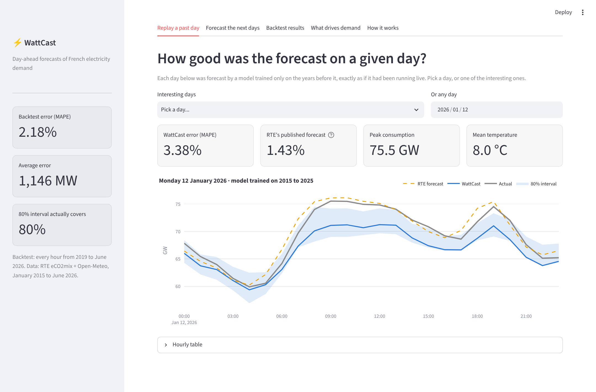
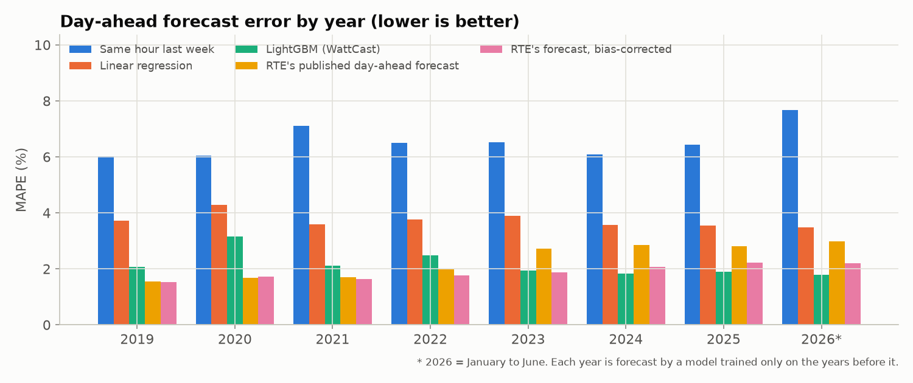
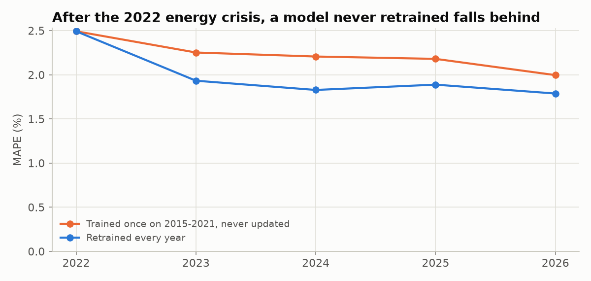
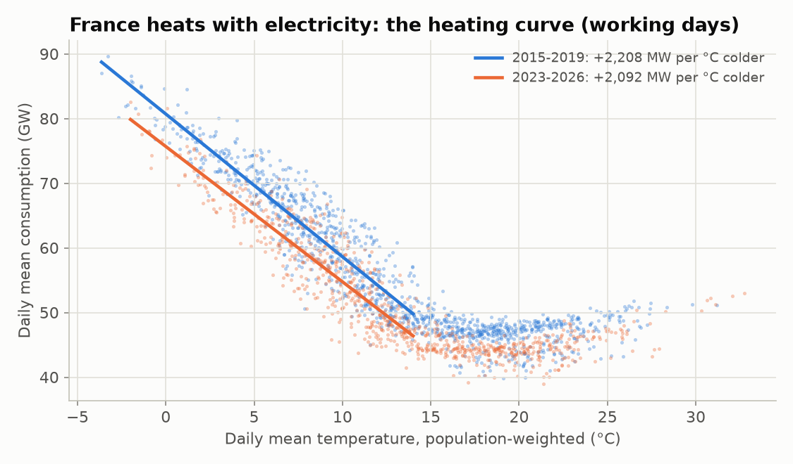
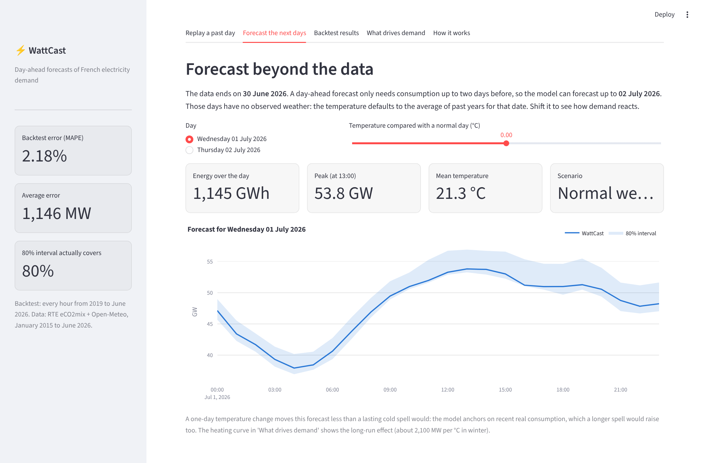

# WattCast: day-ahead forecasting of French electricity demand


WattCast forecasts France's national electricity consumption for each hour of tomorrow, the way the grid operator RTE does every day. It is built on 11 years of RTE eCO2mix data (2015 to June 2026) and hourly temperatures from five large French cities, weighted by population.

It is **backtested over 7.5 years**: every year from 2019 to 2026 is forecast by a model trained only on the years before it, and compared hour by hour with **RTE's own published forecasts**.



## Results (every hour from January 2019 to June 2026)

| Model | MAPE | Average error |
|---|---:|---:|
| Same hour last week (baseline) | 6.47% | 3,496 MW |
| Linear regression (baseline) | 3.75% | 1,878 MW |
| **WattCast (LightGBM)** | **2.18%** | **1,146 MW** |
| RTE's published day-ahead forecast | 2.24% | 1,140 MW |
| RTE's forecast, bias-corrected (see below) | 1.86% | 946 MW |

Each forecast comes with an **80% prediction interval**, which contains the actual value **79.5%** of the time.



### Honest comparison with RTE

On paper, WattCast (2.18%) edges out RTE's published forecast (2.24%). That claim doesn't hold up, for two reasons:

1. **The published RTE forecast has a definition gap.** Since 2023, RTE's published forecast sits about **1.1 GW below** published consumption every year, even for its *same-day* forecast. That points to a difference in what the two series measure, not to bad forecasting. Removing that bias, using only errors known at forecast time (a trailing 28-day average), brings RTE to **1.86%**, better than WattCast.
2. **The backtest uses observed temperatures, i.e. a perfect weather forecast.** RTE has to use real weather forecasts. Adding a realistic 1.5 °C day-ahead temperature error raises WattCast's 2025 error from 1.89% to **2.40%**.

So RTE is better. That's expected: forecasting demand is a core job of the grid operator. Using public data only, WattCast comes within about 0.3 points of the bias-corrected RTE forecast with perfect weather, and roughly 0.8 points once realistic weather-forecast error is included.

| Year | WattCast | RTE published | RTE bias-corrected | Linear | Last week |
|---|---:|---:|---:|---:|---:|
| 2019 | 2.07% | 1.54% | 1.53% | 3.72% | 6.02% |
| 2020 | 3.16% | 1.69% | 1.71% | 4.30% | 6.04% |
| 2021 | 2.11% | 1.71% | 1.64% | 3.60% | 7.10% |
| 2022 | 2.49% | 1.98% | 1.78% | 3.77% | 6.50% |
| 2023 | 1.93% | 2.73% | 1.88% | 3.89% | 6.52% |
| 2024 | 1.83% | 2.86% | 2.07% | 3.57% | 6.09% |
| 2025 | 1.89% | 2.82% | 2.22% | 3.56% | 6.43% |
| 2026 (Jan–Jun) | 1.79% | 2.99% | 2.19% | 3.49% | 7.68% |

## What I learned

**1. The 2022 energy crisis changed consumption, and a model that isn't retrained falls behind.** After the crisis and the government's *sobriété* plan, France uses several GW less at the same temperature (see the heating curve below). A model trained on 2015–2021 and never updated over-forecasts 2023 by about 620 MW on average. Retraining every year cuts its error from 2.25% to 1.93%.



**2. History can't predict a lockdown.** The 10 worst days of the backtest are all from the first COVID lockdown (March–May 2020). WattCast was off by 11–16% on those days, while RTE stayed within 2–6%. A model that learns from consumption 2 and 7 days earlier needs days to catch up with a sudden break. RTE's forecast handled it far better, which suggests it was adjusted for the lockdown.

**3. Prediction intervals must be calibrated.** The raw 10%/90% quantile models covered only **64%** of hours instead of 80%: they were over-confident on new data. *Conformal calibration* fixes this. I hold out the last year of training, measure how much the interval must widen to cover 80% of it, and apply that margin. Coverage becomes 79.5% overall. It still varies by year: too narrow in 2022, the crisis year, and too wide in 2023.

**4. France heats with electricity.** On working days, every degree colder below about 14 °C adds **~2,200 MW** (2015–2019) and **~2,100 MW** (2023–2026). That's measured directly on the data, and in line with RTE's widely quoted figure of about 2,400 MW per °C.



I first tried to get this number from the model ("what if tomorrow were 1 °C colder?") and got only ~1,000 MW per °C. That turned out to be a lesson about lag-based models: they anchor on recent *real* consumption, so a one-day change moves them much less than a lasting cold spell would.

## Features

| Dashboard tab | What it does |
|---|---|
| **Replay a past day** | Any day from 2019 to June 2026, forecast out-of-sample, next to actual consumption and RTE's forecast. Includes presets: a cold snap, the COVID lockdown, the 2019 heatwave, Christmas, a bridge day, a 23-hour clock-change day |
| **Forecast the next days** | Real forecasts for the two days *after* the data ends, with a temperature scenario slider |
| **Backtest results** | All models by year, the lessons above, the 10 hardest days |
| **What drives demand** | Heating curve, what the model relies on, error by hour of day |



## REST API

Start it with `uvicorn api.main:app`. Interactive docs are at `/docs`.

| Endpoint | Description |
|---|---|
| `POST /forecast` | `{"date": "2026-07-01", "temperatures": [...24 values], "temp_offset": 0}`. Hourly forecast with 80% interval. Temperatures are optional (observed if known, otherwise the average of past years) |
| `GET /forecast/{date}?temp_offset=` | Same, with default temperatures |
| `GET /backtest/day/{date}` | The out-of-sample forecast made for a past day, with the actual values and RTE's forecast |
| `GET /model-info` | Backtest metrics, interval coverage, heating slope, experiments |
| `GET /health` | Health check, plus how far the data and the forecasts go |

Clock-change days are handled: 23 hours in March, 25 in October.

## How it works

The forecast for day D is made on D-1, like RTE's day-ahead forecast, so only consumption up to D-2 is used. A test checks that changing consumption on D-1 or D leaves every feature of D unchanged.

**Features:**
- **Calendar:** hour, weekday, season, French public holidays, bridge days (*ponts*), August, Christmas break.
- **Temperature:** population-weighted average of Paris, Lyon, Marseille, Lille and Bordeaux; 24 h and 72 h smoothing (buildings react with inertia); heating and cooling degrees; the day's min/max.
- **Recent consumption:** 2 and 7 days earlier, the average of the previous week, and how much warmer or colder it is now than on those days.

**Models:**
- **Baselines:** same hour last week; a ridge regression.
- **WattCast:** LightGBM (900 trees), plus 10% and 90% quantile LightGBM models for the conformally calibrated interval.
- **Backtest:** an expanding window, retrained every year.

## Run it

```bash
python -m venv .venv
# Windows: .venv\Scripts\activate    macOS/Linux: source .venv/bin/activate
pip install -r requirements.txt

pytest                             # 13 tests
streamlit run dashboard/app.py     # dashboard
uvicorn api.main:app --reload      # API on :8000
python -m wattcast.train           # optional: rerun the full backtest (~3 min)
```

- **Model and data:** the trained model and the processed hourly table are included, so you don't need to retrain or download anything.
- **Docker:** run `docker compose up --build`. The API is on `:8000` and the dashboard on `:8501`.
- **VS Code:** launch configurations are in `.vscode/launch.json`.

## Data

- **RTE eCO2mix national data, "consolidated and definitive"** ([ODRE](https://odre.opendatasoft.com/explore/dataset/eco2mix-national-cons-def/)). Consumption every 30 min and RTE's forecasts every 15 min, both averaged to hourly. Licence Ouverte / Etalab.
- **[Open-Meteo](https://open-meteo.com/) historical weather API.** Hourly 2 m temperature (CC BY 4.0).

To rebuild `data/processed/hourly.parquet` from scratch, save the raw files in `data/raw/` as `eco2mix-national-cons-def.csv` and `weather_*.csv`, then run `python -m wattcast.data`.

## Limitations

- **Observed, not forecast, temperatures.** The backtest uses observed temperatures; the realistic cost of that is measured above (+0.5 points of error).
- **Temperature only.** National level, with no other weather: wind chill, sunshine and cloud cover all affect demand too.
- **Blind to exceptional events** (strikes, lockdowns, extreme cold-weather alerts) until they show up in recent consumption.
- **Approximate city weights.** The population weights are rounded metropolitan populations; RTE uses its own national reference temperature, built from many more weather stations.
